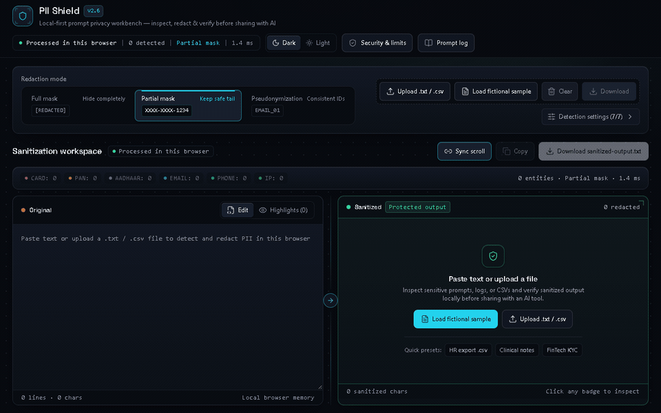
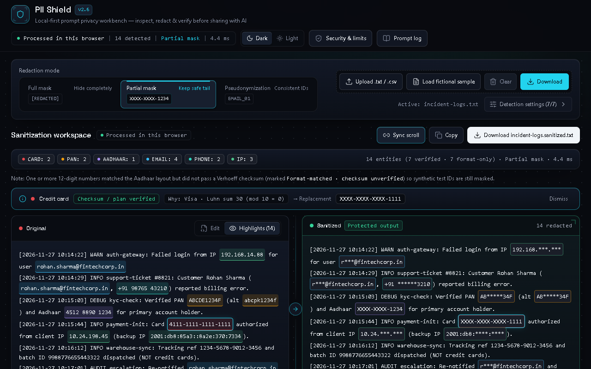
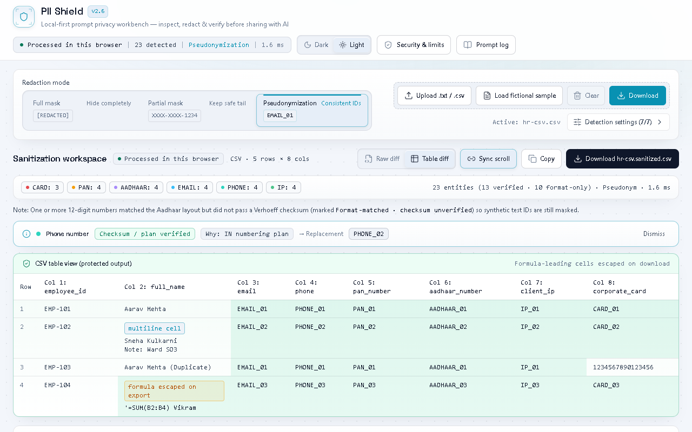
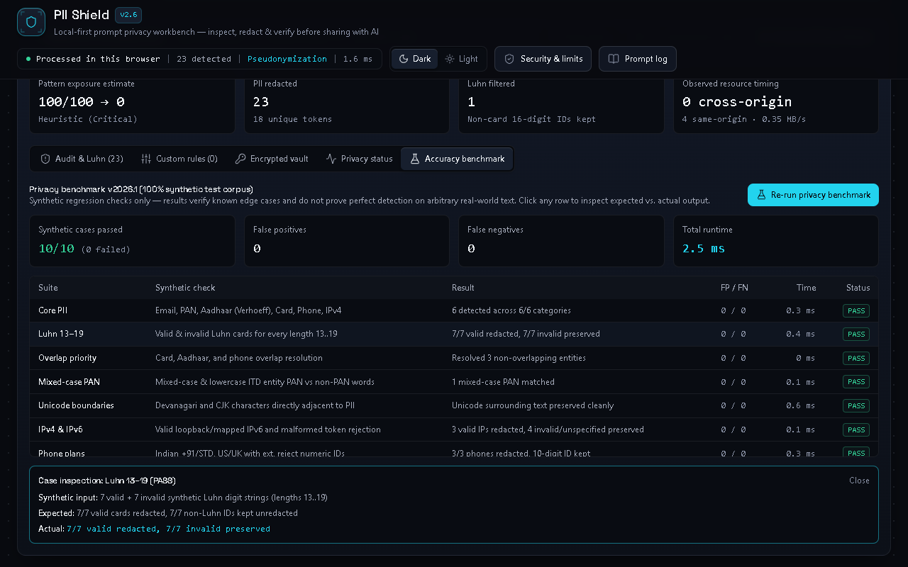

# PII Shield (`promptwars-pii-shield`)

> **PromptWars × NIAT Pune 2026 — Cybersecurity & Data Privacy Track**  
> **Live App:** https://promptwars-pii-shield.vercel.app  
> A **local-first prompt privacy workbench** that lets users inspect sensitive prompts, logs, tickets, resumes, and CSVs, redact PII inside browser memory, and verify the sanitized output—and browser resource behavior—before sharing with an AI tool.

---

## Live Demo & Screenshots



| Sanitization Workspace (Dark Theme) | CSV Table Diff & Formula Protection (Light Theme) |
| --- | --- |
|  |  |

| Verifiable Privacy Status & 10-Case Synthetic Benchmark |
| --- |
|  |

---

## Why Local-First Prompt Privacy Matters

Pasting raw logs, support exports, or spreadsheets into external AI tools exposes payment cards, government IDs, phone numbers, and internal IPs before a prompt ever receives a response. Sending that raw payload to a third-party redaction server only shifts the trust boundary. PII Shield runs the entire detection, validation, pseudonymization, CSV escaping, and audit workflow **inside the user's own browser tab**.

---

## Key Capabilities & Supported Formats

- **Processed in This Browser:** Scanning, Luhn/Verhoeff validation, bundled `libphonenumber-js/max` numbering-plan checks, linear-time `re2js` rules (Web Worker), CSV escaping, and downloads execute locally in memory using locally bundled `@fontsource/space-grotesk` and system fonts.
- **6 Built-in PII Detectors + Standards Validators:**
  - **Credit Cards (13–19 digits):** Luhn mod-10 checksum validated to prevent false positives on random tracking/order IDs.
  - **Indian PAN:** Uppercase (`ABCDE1234F`) and mixed/lowercase ITD entity-coded formats.
  - **Indian Aadhaar (12 digits):** Format-matched and explicitly tagged as `Verhoeff checksum verified` or `Format-matched · checksum unverified`.
  - **Phone Numbers:** Locally bundled `libphonenumber-js/max` numbering-plan validation for Indian (`+91`, `0`-prefixed STD, 10-digit mobile) and international E.164 formats with extensions.
  - **IPv4 & IPv6:** Strict `0–255` IPv4 octets and RFC 4291/5952 IPv6 (full, compressed, loopback `::1`, IPv4-mapped `::ffff:192.0.2.128`; unspecified `::` excluded; malformed/overlong spans preserved intact).
  - **Email Addresses** + **Unicode boundary safety**.
- **Three Redaction Modes:** `Full mask` (`[REDACTED]` or typed tags), `Partial mask` (`XXXX-XXXX-1234`), and `Pseudonymization` (`EMAIL_01`, `CARD_01`) consistent across multiline CSV tables.
- **Linear-Time Custom Rules (`re2js`):** User-defined patterns compile via Google's RE2 engine (`re2js`) inside a Web Worker with an 800 ms watchdog—preventing catastrophic ReDoS freezes on patterns like `(a+)+$`.
- **CSV Hardening:** `parseCsvStrict()` reports unterminated/invalid quotes, `escapeCsvFormula()` neutralizes `=`, `+`, `-`, `@`, `\t`, `\r` even after leading spaces/control characters, and **Table diff** flags multiline and formula-escaped cells explicitly.
- **Metadata-Only Privacy Receipt (`pii-privacy-receipt.json`):** Downloads sanitization timestamp, mode, counts by category, validation summary, synthetic benchmark status, and processing ms—containing zero original PII, raw text, or unsanitized filenames.
- **Encrypted Local Vault:** `PBKDF2-SHA256` (**600,000 iterations**) + `AES-GCM-256` with 12+ char mixed passphrase enforcement.
- **Dark & Light Themes:** Instant header switcher (`Dark` / `Light`) persisting only the UI theme preference locally (`pii-shield-theme`).

---

## Privacy Design & What Has Been Verified

PII Shield explicitly distinguishes **user text transmission** from **page asset requests**:

1. **No User Text Is Transmitted:** Pasted text, uploaded `.txt`/`.csv` files, custom rules, and redaction results stay in browser memory (`src/engine/` and `src/workers/sanitizer.worker.ts`) and are never sent to any backend or AI endpoint.
2. **Page Network Requests:** Loading the application itself fetches static files from this origin (`index.html`, JS, CSS, bundled `.woff2` fonts). No external CDNs, analytics, remote APIs, or third-party fonts are included.
3. **Verifiable Browser Check & Security Headers:**
   - The in-app **Privacy status** panel inspects `performance.getEntriesByType('resource')` in the active tab to report observed same-origin vs. cross-origin entries, alongside a reminder to inspect DevTools → Network directly.
   - Deployed Vercel headers (`vercel.json`) enforce `Content-Security-Policy: default-src 'self'; script-src 'self'; style-src 'self' 'unsafe-inline'; font-src 'self'; img-src 'self' data:; connect-src 'none'; frame-ancestors 'none'; base-uri 'self'; form-action 'none';`, `X-Frame-Options: DENY`, `Referrer-Policy: no-referrer`, `X-Content-Type-Options: nosniff`, and HSTS.
   - Automated Vitest + live browser checks verified `0` third-party runtime requests and `0` leaked PII/filenames in downloaded Privacy Receipts.

---

## Known Limitations (Important Warning)

> **Warning:** Pattern-based and rule-based detection **is not perfect** and does not guarantee 100% recall or zero false positives on arbitrary real-world text.

- Unstructured prose PII (free-form person names, street addresses, or custom internal secrets) is not automatically detected unless targeted with a custom RE2 rule.
- Unprefixed 10-digit Indian phone numbers are limited to mobile prefixes (`6–9`) so arbitrary numeric IDs are preserved; STD landlines require leading `0` or `+91`.
- Benchmark scores (`Run privacy benchmark`) measure a **100% synthetic test corpus** covering known edge cases (`10/10` synthetic suites) and must not be read as a compliance certification or perfection guarantee on arbitrary input. Always review the sanitized diff before sharing sensitive files.

---

## How AI Tools & Google Technologies Contributed

- **Google Antigravity:** Used for iterative architecture design, edge-case hardening, synthetic benchmark construction, accessibility fixes, and UI refinement—documented in [`PROMPT_LOG.md`](./PROMPT_LOG.md).
- **Google RE2 (`re2js`) & `libphonenumber` (`libphonenumber-js/max`):** Bundled locally for guaranteed linear-time regex execution and offline telecom numbering-plan checks.
- **Chrome Built-in AI (`LanguageModel`):** Optional local summary over aggregate entity counts only (`src/engine/chromeAi.ts`) when available in Chrome.
- **Cloud Run / Firebase Templates:** Container and header configurations included in [`Dockerfile`](./Dockerfile), [`nginx.conf.template`](./nginx.conf.template), [`cloudbuild.yaml`](./cloudbuild.yaml), and [`firebase.json`](./firebase.json).

---

## Quick Start & Checks

```bash
npm install
npm test        # Run Vitest unit, benchmark, receipt & UI accessibility suite (24 tests)
npm run lint    # Run oxlint static checks
npm run build   # Type-check + build production bundle in dist/
npm run dev     # Start local dev server
```

## Credits

UI design refinements adapted from [unslop](https://github.com/heydamir/unslop) by Damir Sokolovsky ([@heydamir](https://x.com/heydamir)), licensed under [CC BY 4.0](https://creativecommons.org/licenses/by/4.0/).
